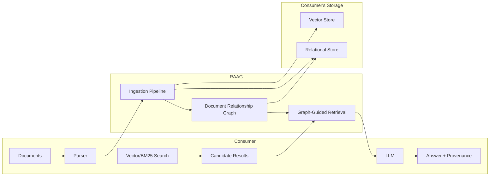
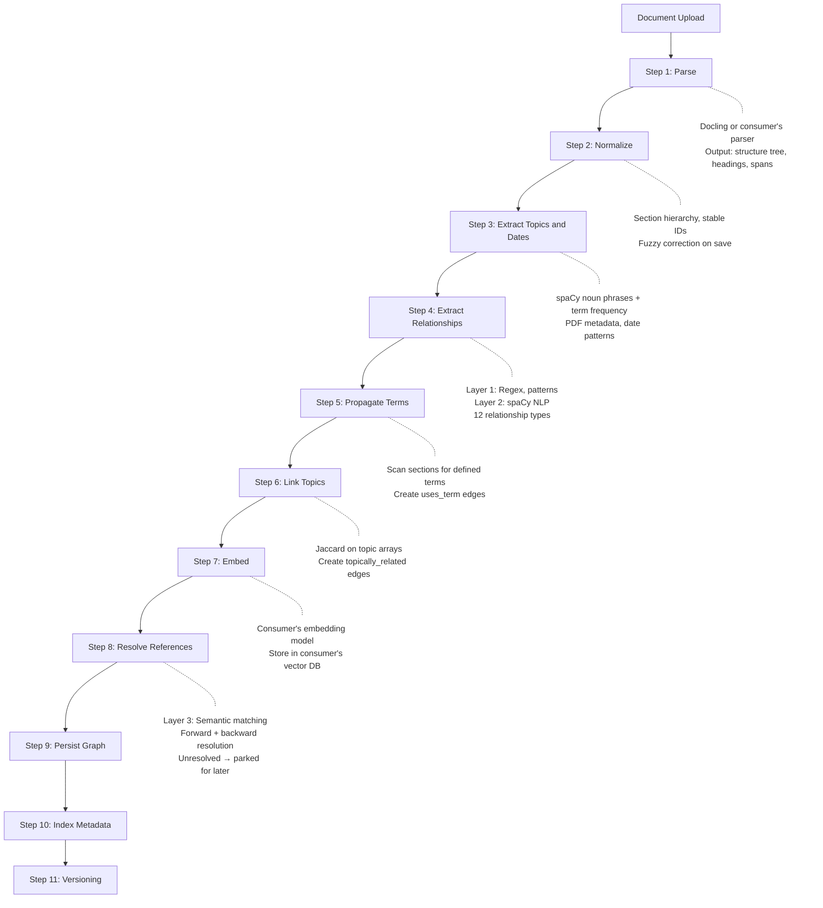
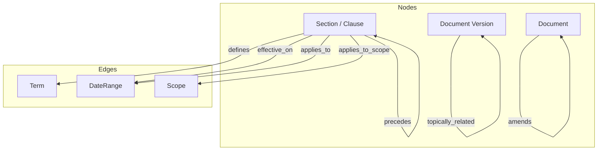
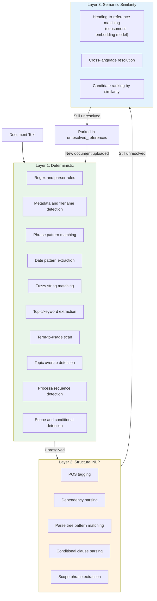
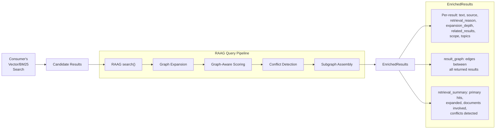
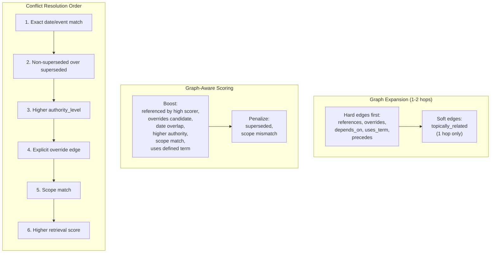
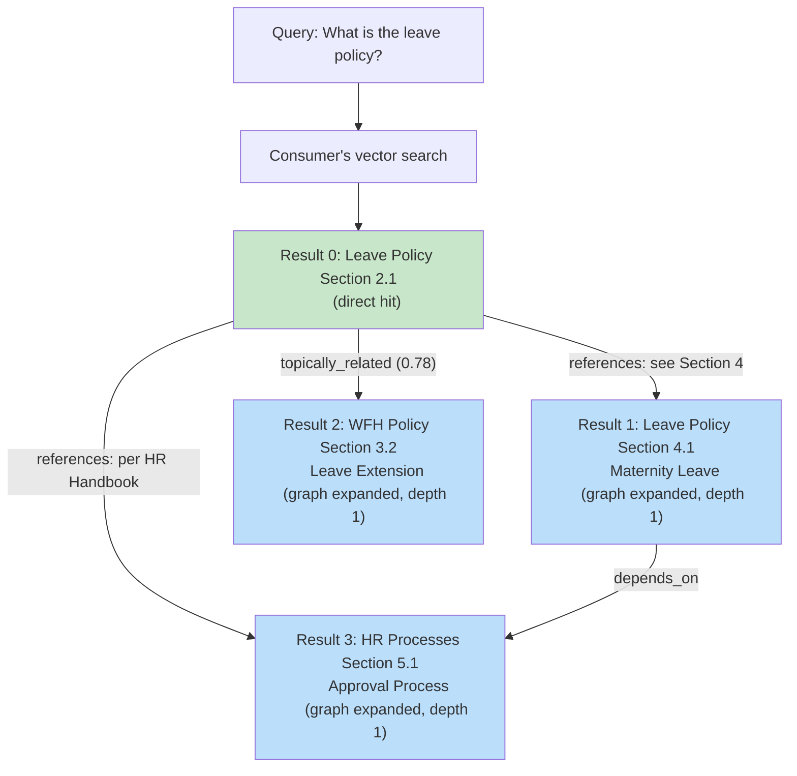

# RAAG: Relationship-Aware Augmented Generation

**Structure-derived document relationship intelligence for RAG pipelines.**

RAAG is a Python SDK that makes retrieval relationship-aware without LLM extraction. It ingests documents, derives cross-document relationships from structure and explicit patterns, and guides retrieval using a document relationship graph.

RAAG is not a RAG framework. Not a vector database. Not an embedding model. It is the intelligence layer between documents and retrieval.

---

## Installation

```bash
# Core library (no vector DB dependency)
pip install raag
```

### Vector Store Adapters

RAAG ships optional adapters for popular vector databases. Install the one you use:

```bash
pip install raag[qdrant]       # Qdrant
```

More adapters coming: `chromadb`, `pinecone`, `pgvector`, `weaviate`.

### Bring Your Own

RAAG defines a `VectorStore` Protocol with three methods: `upsert`, `search`, `delete`. If your vector DB isn't listed above, wrap it yourself:

```python
from raag.protocols import VectorStore, VectorItem, VectorSearchResult

class MyVectorStore:
    async def upsert(self, items: list[VectorItem]) -> None: ...
    async def search(self, vector: list[float], k: int, tenant_id: str) -> list[VectorSearchResult]: ...
    async def delete(self, ids: list[str], tenant_id: str) -> None: ...
```

No base class needed. If it matches the protocol, it works.

---

## How It Works

### Architecture



RAAG sits between parsing and retrieval. The consumer owns the parser, the embedding model, the vector store, and the LLM. RAAG owns the relationship graph and the retrieval enrichment logic.

---

### Ingestion Pipeline

When a document is uploaded via `add_document()`:



---

### Document Relationship Graph



Every edge carries provenance: the matched text that triggered extraction, normalized target, confidence score, and optional condition/scope fields.

---

### Extraction Layers



Layer 1 is fast, deterministic, and free. Layer 2 uses spaCy (no LLM). Layer 3 uses the consumer's embedding model. Cost and latency increase with each layer. Most references resolve at Layer 1.

---

### Query-Time Flow

When `search()` is called with candidate results from the consumer's pipeline:





---

### Example: Multi-Document Answer



The consumer's LLM receives this subgraph and can synthesize: "Employees get 30 days annual leave (Leave Policy Section 2.1), with 90 days for maternity (Section 4.1). Leave can be extended using WFH policy (WFH Policy Section 3.2) but requires written permission from the immediate manager (HR Processes Section 5.1)."

Every claim traced to a specific source section.

---

## Quick Start

```python
from raag import RAAG

raag = RAAG(
    db=postgres_connection,          # graph and metadata storage
    embed=my_embedding_function,     # your embedding model
    vector_store=my_vector_client,   # your vector DB
    parser=docling_parser,           # optional, defaults to Docling
)

# Ingest a document
result = raag.add_document(file="leave_policy.pdf", metadata={
    "doc_type": "policy",
    "authority_level": 50
})

# Enrich retrieval results
candidates = my_vector_search("leave policy", top_k=5)
enriched = raag.search(
    query_results=candidates,
    as_of_date="2026-01-15",
    max_expansion_hops=1,
    scope_context="full-time"
)

# enriched.results       -> per-result data with provenance
# enriched.result_graph  -> edges between results
# enriched.retrieval_summary -> documents involved, conflicts detected
```

---

## Key Design Decisions

| # | Decision |
|---|----------|
| 1 | No LLM dependency for core extraction. Deterministic, structure-derived. |
| 2 | Consumer provides embedding model. RAAG uses it for embedding AND semantic similarity. |
| 3 | Storage agnostic. Abstract interface with adapters. PostgreSQL reference adapter included. |
| 4 | Embeddings stored in consumer's vector store, not in RAAG metadata. |
| 5 | Search returns a result subgraph (not a flat list). Includes relationship map and retrieval summary. |
| 6 | Graph expansion: default 1 hop, max 2 hops. Configurable per query. |
| 7 | Multi-lingual support delegated to consumer's embedding model capability. |
| 8 | spaCy for structural NLP only (POS tagging, dependency parsing). Not for similarity. |
| 9 | Fuzzy string matching (Levenshtein) for OCR correction. Normalized on save, raw preserved. |

---

## Relationship Types

| Edge | Detection | Example |
|------|-----------|---------|
| `references` | Regex, NLP, semantic | "as defined in Section 4.2" |
| `overrides` | Phrase patterns | "notwithstanding Section 3" |
| `supersedes` | Metadata, filenames | Rev.B supersedes Rev.A |
| `amends` | Metadata, patterns | Amendment 3 amends the Master Agreement |
| `defines` | Definition section patterns | Section 1.1 defines "Force Majeure" |
| `uses_term` | Regex on known term list | Section 8.3 uses "Force Majeure" |
| `depends_on` | Cross-reference patterns | Clause requires another clause |
| `precedes` | Sequential step patterns | Step 1 before Step 2 |
| `applies_to` | Date patterns | "purchases between 2000-2005" |
| `effective_on` | Date patterns | "effective from January 1, 2024" |
| `topically_related` | Jaccard on topic arrays | Leave Policy and WFH Policy share topics |
| `applies_to_scope` | Scope phrase patterns | "applies to full-time employees" |

---

*RAAG: Relationship-Aware Augmented Generation. By [AALA AI](https://aala.ai).*
